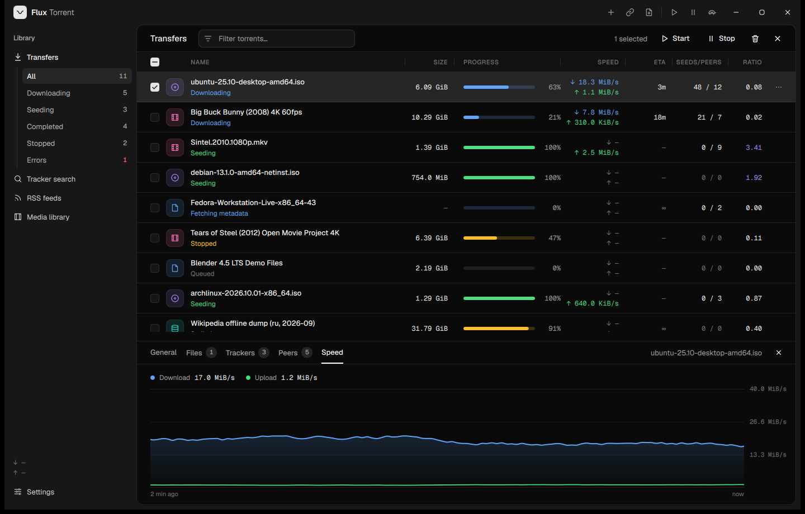
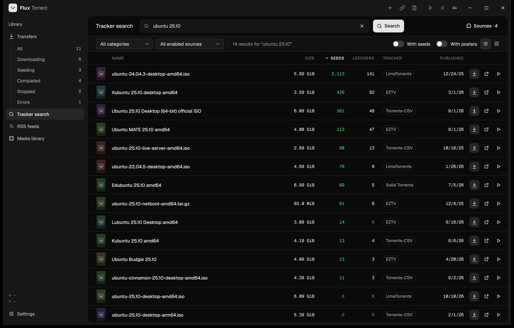
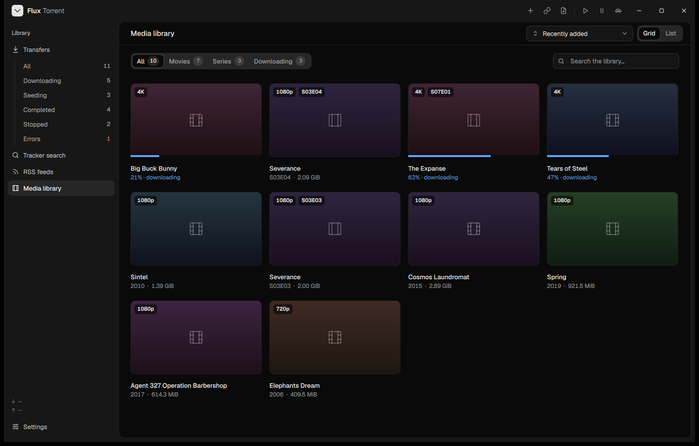
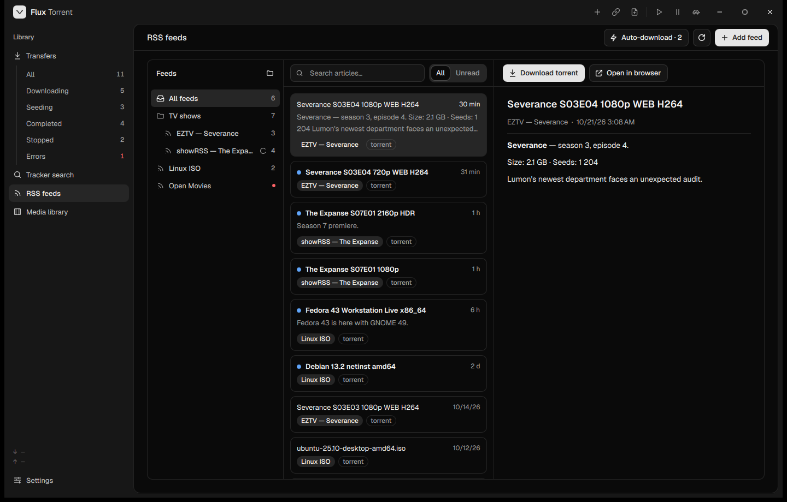
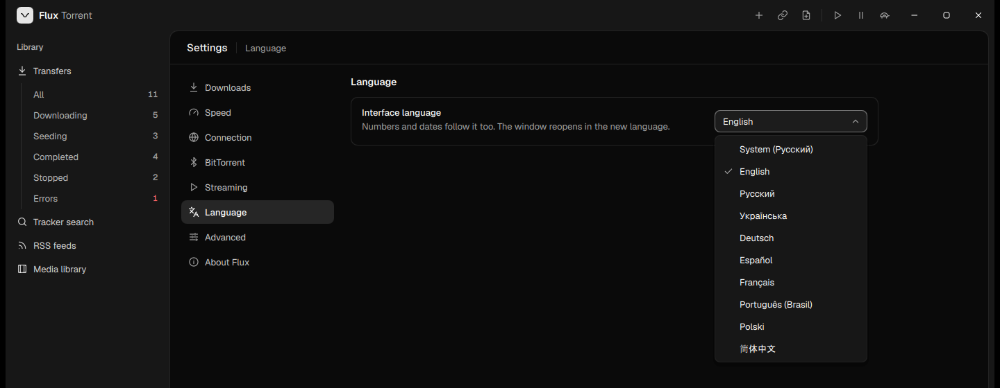

<!-- Language switcher: keep in sync with docs/i18n/README.*.md -->
<p align="center">
  <a href="../../README.md">English</a> ·
  <b>Русский</b> ·
  <a href="README.uk.md">Українська</a> ·
  <a href="README.de.md">Deutsch</a> ·
  <a href="README.es.md">Español</a> ·
  <a href="README.fr.md">Français</a> ·
  <a href="README.pt-BR.md">Português</a> ·
  <a href="README.pl.md">Polski</a> ·
  <a href="README.zh-CN.md">简体中文</a>
</p>

<p align="center">
  
</p>

<h1 align="center">Flux Torrent</h1>

<p align="center">
  <b>Торрент-клиент, на который действительно приятно смотреть.</b><br>
  Надёжное ядро qBittorrent, совершенно новый интерфейс и плеер, который запускает фильм, пока тот ещё скачивается.
</p>

<p align="center">
  <a href="https://github.com/pinkmoneyx-bigguys/flux-torrent/releases/latest"></a>
  <a href="https://github.com/pinkmoneyx-bigguys/flux-torrent/releases"></a>
  
  
  
  
  <a href="../../COPYING"></a>
</p>

<p align="center">
  <a href="https://github.com/pinkmoneyx-bigguys/flux-torrent/releases/latest"><b>⬇ Скачать для Windows</b></a>
  &nbsp;·&nbsp;
  <a href="https://pinkmoneyx-bigguys.github.io/flux-torrent/"><b>Сайт</b></a>
  &nbsp;·&nbsp;
  <a href="#-возможности">Возможности</a>
  &nbsp;·&nbsp;
  <a href="#-скриншоты">Скриншоты</a>
  &nbsp;·&nbsp;
  <a href="#-faq">FAQ</a>
  &nbsp;·&nbsp;
  <a href="#-сборка-из-исходников">Сборка</a>
</p>

<p align="center">
  
</p>

---

## 💡 Почему Flux

qBittorrent — самый надёжный торрент-движок с открытым исходным кодом. Но выглядит он до сих пор так, будто на дворе 2010-й.
Flux оставляет этот движок **нетронутым** (qBittorrent 5.2.4 на libtorrent 2.0) и выстраивает вокруг него современное приложение для Windows:

- 🎬 **Сначала смотреть, потом скачивать.** Нажмите «плей» на торренте — и фильм начнётся через пару секунд: Flux первым делом загружает те части, которые вот-вот появятся на экране.
- 🔎 **Поиск, который разбирается в кино.** Результаты сгруппированы по фильмам: постер, год и все раздачи — в одной карточке.
- ✨ **Спокойный и быстрый интерфейс.** Тёмный, аккуратный и плавный, с живыми графиками и цифрами, которые перекатываются, а не мигают.
- 🧳 **Ничего не потеряется.** При первом запуске раздачи и настройки из qBittorrent переносятся в один клик.

## ✨ Возможности

<table>
  <tr>
    <td width="50%" valign="top">
      <h3>🎬 Встроенный плеер и стриминг</h3>
      Смотрите видео, пока торрент ещё качается. Flux в первую очередь запрашивает части прямо перед текущей позицией, честно показывает заполнение буфера и запоминает, где вы остановились.
      <br><br>
      Режим <b>«Смотреть без скачивания»</b> держит фильм во временном кэше и очищает его, когда вы досмотрите, — на диске ничего не копится.
    </td>
    <td width="50%" valign="top">
      <h3>🔎 Поиск по трекерам с постерами</h3>
      Встроенный источник фильмов и сериалов (JacRed) работает сразу, без всякого Python, — рядом с классическими поисковыми плагинами qBittorrent.
      <br><br>
      Результаты превращаются в <b>карточки фильмов</b>: постеры с IMDb, Wikipedia и Shikimori, все раздачи фильма в одном месте, переключатели «С сидами» и «С постерами», вид списком или сеткой.
    </td>
  </tr>
  <tr>
    <td width="50%" valign="top">
      <h3>📊 Передачи, в которых всё понятно</h3>
      Строки в две линии с ясными статусами, живой график скорости для каждого торрента, бегущие цифры скорости, колонки с изменяемой шириной и панель подробностей с частями, файлами, трекерами и пирами.
      <br><br>
      Только что запущенный торрент пишет <i>«Подключение к пирам…»</i>, а не делает вид, что завис.
    </td>
    <td width="50%" valign="top">
      <h3>📚 Медиатека</h3>
      Всё видео из ваших торрентов, разложенное по фильмам и сериалам — с сезонами и сериями, значками качества и прогрессом просмотра. Запускается всё с одного экрана.
    </td>
  </tr>
  <tr>
    <td width="50%" valign="top">
      <h3>📰 RSS с автозагрузкой</h3>
      Ленты и папки, удобная читалка статей и правила, которые сами забирают новые серии, как только те выходят.
    </td>
    <td width="50%" valign="top">
      <h3>⌨️ Всё с клавиатуры</h3>
      <kbd>Ctrl</kbd> + <kbd>K</kbd> открывает палитру команд на все случаи: добавить торрент, перейти на нужную страницу, переключить ограничения скорости, проверить обновления…
    </td>
  </tr>
  <tr>
    <td width="50%" valign="top">
      <h3>🔄 Обновляется сам</h3>
      При запуске Flux проверяет релизы на GitHub. Один клик по <b>«Обновить и перезапустить»</b> — и новая версия скачивается, проходит проверку контрольной суммы SHA-256, встаёт на место и открывается заново.
    </td>
    <td width="50%" valign="top">
      <h3>🌍 Говорит на вашем языке</h3>
      English, Русский, Українська, Deutsch, Español, Français, Português (Brasil), Polski и 简体中文. Язык переключается за секунду, без перезапуска, а числа и даты подстраиваются под него.
    </td>
  </tr>
</table>

И всё привычное по qBittorrent никуда не делось: последовательная загрузка и приоритет первых и последних частей, категории, ограничения скорости по расписанию, очередь, DHT / PeX / LSD, шифрование, прокси, UPnP / NAT-PMP, создание торрентов и полный набор расширенных настроек libtorrent.

## 📸 Скриншоты

<table>
  <tr>
    <td width="50%"><p align="center"><sub>Поиск по трекерам</sub></p></td>
    <td width="50%"><p align="center"><sub>Медиатека</sub></p></td>
  </tr>
  <tr>
    <td width="50%"><p align="center"><sub>RSS-ленты и читалка статей</sub></p></td>
    <td width="50%"><p align="center"><sub>Девять языков, переключение на лету</sub></p></td>
  </tr>
</table>

## 🚀 Начало работы

Скачайте один из двух файлов из [последнего релиза](https://github.com/pinkmoneyx-bigguys/flux-torrent/releases/latest):

| | |
|---|---|
| 📦 **`Flux-<version>-setup.exe`** — *рекомендуется* | Установщик в фирменном стиле Flux. Устанавливает программу только для вас, поэтому права администратора не нужны; добавляет ярлыки в меню «Пуск» и на рабочий стол, открывает файлы `.torrent` и magnet-ссылки, а удалить Flux можно через раздел *«Установленные приложения»*. Новые версии устанавливаются поверх прежней. |
| 🧳 **`Flux-<version>-portable-win64.zip`** | Портативная версия. Распакуйте её куда угодно — подойдёт и флешка — и запустите `Flux.exe`. Настройки и раздачи хранятся в её папке `profile`, и обновляется она тоже сама. |

При первом запуске Flux предложит **перенести раздачи и настройки из qBittorrent**. Сначала закройте qBittorrent, затем нажмите *«Перенести»*. Хотите начать с нуля? Выберите *«Начать с чистого листа»*.

**Системные требования:** Windows 10 (1809 или новее) или Windows 11, 64-бит. Больше ничего устанавливать не нужно: всё необходимое Flux несёт с собой.

## ⌨️ Горячие клавиши

| Сочетание | Действие | | В плеере | Действие |
|---|---|---|---|---|
| <kbd>Ctrl</kbd> <kbd>K</kbd> | Палитра команд | | <kbd>Space</kbd> | Воспроизведение / пауза |
| <kbd>Ctrl</kbd> <kbd>O</kbd> | Добавить торрент-файл | | <kbd>←</kbd> <kbd>→</kbd> | Перемотка назад / вперёд |
| <kbd>Ctrl</kbd> <kbd>1</kbd>…<kbd>4</kbd> | Передачи, поиск, RSS, медиатека | | <kbd>↑</kbd> <kbd>↓</kbd> | Громкость |
| <kbd>Ctrl</kbd> <kbd>,</kbd> | Настройки | | <kbd>M</kbd> | Без звука |
| <kbd>Ctrl</kbd> <kbd>B</kbd> | Свернуть меню | | <kbd>F</kbd> | Во весь экран |
| | | | <kbd>Esc</kbd> | Выйти из плеера |

## ❓ FAQ

<details>
<summary><b>Flux — это форк qBittorrent?</b></summary>
<br>
Да. Движок — сессии, данные возобновления, трекеры, сам протокол BitTorrent — это qBittorrent 5.2.4 на libtorrent 2.0.11. Flux заменяет интерфейс новым, написанным на Qt Quick (QML), и добавляет поверх стриминг, плеер, медиатеку, поиск фильмов и автообновление.
</details>

<details>
<summary><b>Он не испортит мой qBittorrent?</b></summary>
<br>
Нет. У Flux свой профиль (<code>%APPDATA%\Flux</code> и <code>%LOCALAPPDATA%\Flux</code>). При переносе раздачи и настройки qBittorrent <i>копируются</i>, а исходный профиль остаётся как был. Главное — не запускайте одни и те же торренты в обоих приложениях одновременно.
</details>

<details>
<summary><b>Почему после «Запустить» торрент набирает скорость только через несколько секунд?</b></summary>
<br>
Остановка торрента закрывает его соединения. При запуске Flux заново связывается с пирами, а когда начинать отдачу, решают уже они — большинство клиентов пересматривают это раз в 10–15 секунд. Всё это время Flux показывает <i>«Подключение к пирам…»</i>. qBittorrent ведёт себя точно так же.
</details>

<details>
<summary><b>Windows называет установщик «неопознанным приложением». Это безопасно?</b></summary>
<br>
SmartScreen предупреждает о каждой новой программе, у которой ещё нет платного сертификата для подписи кода, а у Flux его нет. Нажмите <i>«Подробнее»</i> → <i>«Выполнить в любом случае»</i>. Чтобы убедиться, что файл тот самый, что опубликован здесь, сравните его SHA-256 с <code>SHA256SUMS.txt</code> из релиза (<code>Get-FileHash Flux-&lt;version&gt;-setup.exe</code> в PowerShell).
</details>

<details>
<summary><b>Как удалить Flux?</b></summary>
<br>
Откройте <i>«Параметры → Приложения → Установленные приложения»</i>, найдите <b>Flux Torrent</b> и выберите <i>«Удалить»</i>. Деинсталлятор спросит, сохранить ли ваши настройки и список раздач; скачанные файлы он никогда не трогает. Портативная версия — это просто папка: удалите её.
</details>

<details>
<summary><b>Нужен ли Python для поиска?</b></summary>
<br>
Для встроенного источника фильмов и сериалов — нет. Python нужен только для классических поисковых плагинов qBittorrent, как и в самом qBittorrent.
</details>

<details>
<summary><b>Есть ли веб-интерфейс, версия для Linux или macOS?</b></summary>
<br>
Пока Flux работает только в Windows. Веб-интерфейс qBittorrent по-прежнему встроен (по умолчанию он выключен, включить его можно в файле конфигурации).
</details>

<details>
<summary><b>Это законно?</b></summary>
<br>
BitTorrent — технология обмена файлами, которой каждый день пользуются для дистрибутивов Linux, игр, открытых фильмов и резервных копий. Flux — такой же клиент, как любой другой. За то, что вы скачиваете и раздаёте, отвечаете вы сами, — пожалуйста, соблюдайте законы своей страны.
</details>

## 🛠 Сборка из исходников

<details>
<summary><b>Показать шаги</b></summary>
<br>

Всё автоматизировано скриптами на PowerShell. Первый скрипт устанавливает инструменты сборки (Visual Studio 2022 Build Tools, Python 3.13, CMake, Ninja, Qt 6.10.1, vcpkg с OpenSSL, zlib, Boost 1.90 и libtorrent 2.0.11, libmpv) и фиксирует их версии в <a href="../../scripts/deps.lock"><code>scripts/deps.lock</code></a>.

```powershell
# 1. Инструменты сборки и зависимости (один раз, в PowerShell от имени администратора)
powershell -ExecutionPolicy Bypass -File scripts/setup-env.ps1

# 2. Собрать QML-интерфейс и прогнать тесты
powershell -ExecutionPolicy Bypass -File scripts/build.ps1 -Gui Qml -Test

# 3. Сложить в deploy\ готовую к запуску копию вместе с Qt и DLL
powershell -ExecutionPolicy Bypass -File scripts/build.ps1 -Gui Qml -Deploy

# 4. Релиз в dist\: установщик, портативный zip, контрольные суммы и описание релиза
powershell -ExecutionPolicy Bypass -File scripts/release.ps1
```

Опубликуйте файлы из <code>dist\</code> в релизе на GitHub с тегом <code>v&lt;version&gt;</code> (см. <a href="../../CHANGELOG.md"><code>CHANGELOG.md</code></a>) — и каждый Flux предложит обновиться: установленный возьмёт установщик, портативный — zip.

**Структура проекта**

| Путь | Что там лежит |
|---|---|
| `src/base`, `src/app` | Движок и приложение qBittorrent, максимально близкие к оригиналу |
| `src/qmlgui/qml` | Интерфейс: страницы, элементы управления, плеер |
| `src/qmlgui/backend` | Модели на C++, с которыми работает интерфейс (торренты, поиск, постеры, RSS, обновления, языки…) |
| `src/qmlgui/streaming` | Стриминг: планирование упреждающей загрузки и локальный сервер потока |
| `src/qmlgui/i18n` | Переводы (`flux_<code>.ts`) |
| `src/installer` | Установщик: самораспаковывающийся загрузчик без зависимостей и интерфейс установки на QML |
| `test/qmlgui` | Тесты на C++ и QML |

</details>

## 🌍 Переводы

Flux переведён на 9 языков. Строки лежат в [`src/qmlgui/i18n`](../../src/qmlgui/i18n) — по одному файлу Qt `.ts` на язык; открыть их можно в Qt Linguist или в любом текстовом редакторе.

Заметили неуклюжую фразу или хотите добавить свой язык? [Напишите в Issues](https://github.com/pinkmoneyx-bigguys/flux-torrent/issues) или пришлите pull request — в [`CONTRIBUTING.md`](../../CONTRIBUTING.md) описано, где что лежит, а проверка в каждом pull request’е следит, чтобы перевод был полным и все плейсхолдеры остались на месте.

## 🤝 Участие в разработке

Будем рады сообщениям об ошибках, идеям и pull request’ам — подробности в [`CONTRIBUTING.md`](../../CONTRIBUTING.md). Прежде чем отправить pull request, пожалуйста, прогоните тесты:

```powershell
powershell -ExecutionPolicy Bypass -File scripts/build.ps1 -Gui Qml -Test
```

## 🙏 Благодарности

Flux стоит на плечах замечательных проектов с открытым исходным кодом:

- [qBittorrent](https://www.qbittorrent.org) — движок и всё, что делает его надёжным
- [libtorrent](https://libtorrent.org) (автор — Arvid Norberg) — реализация протокола BitTorrent
- [Qt](https://www.qt.io) — фреймворк, на котором построен интерфейс
- [mpv](https://mpv.io) — движок встроенного плеера
- [QWindowKit](https://github.com/stdware/qwindowkit) — окно без рамки с нативной привязкой к краям экрана
- [JacRed](https://jac.red) — источник для поиска фильмов и сериалов
- Постеры с [IMDb](https://www.imdb.com), [Wikipedia](https://www.wikipedia.org) и [Shikimori](https://shikimori.io)
- Шрифты [Geist](https://fonts.google.com/specimen/Geist), [Onest](https://fonts.google.com/specimen/Onest), [Unbounded](https://fonts.google.com/specimen/Unbounded) и [JetBrains Mono](https://fonts.google.com/specimen/JetBrains+Mono); иконки в стиле [Lucide](https://lucide.dev)

## 📄 Лицензия

Flux, как и qBittorrent, — свободное программное обеспечение под лицензией [GNU General Public License v2.0 или более поздней версии](../../COPYING) с исключением для компоновки с OpenSSL. Подробности — в [`COPYING`](../../COPYING), [`COPYING.GPLv2`](../../COPYING.GPLv2) и [`COPYING.GPLv3`](../../COPYING.GPLv3).

<p align="center"><sub>Сделано с заботой о тех, кто просто хочет, чтобы торренты работали — и при этом хорошо выглядели.</sub></p>
